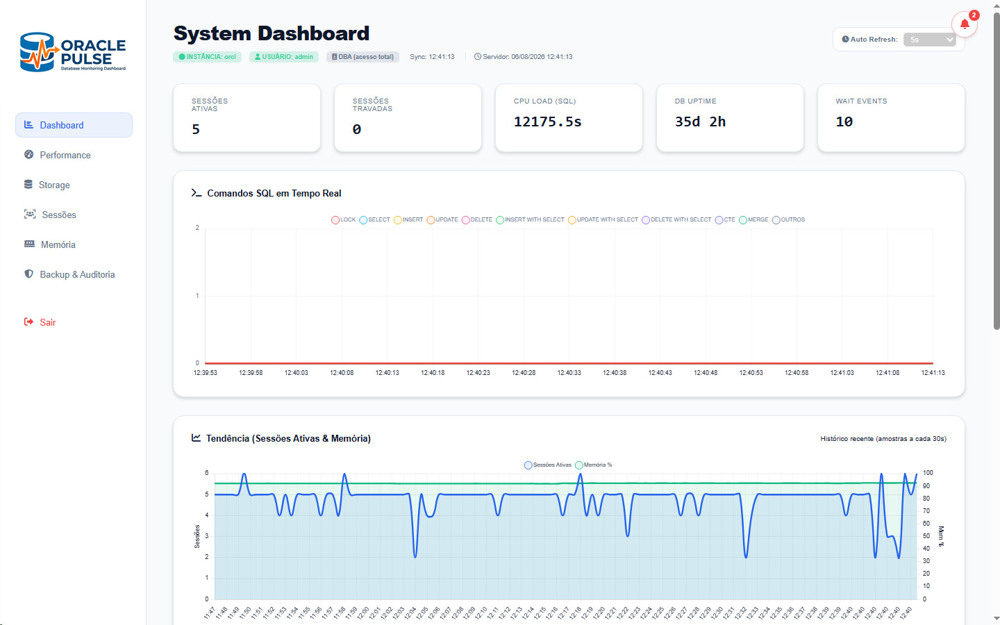
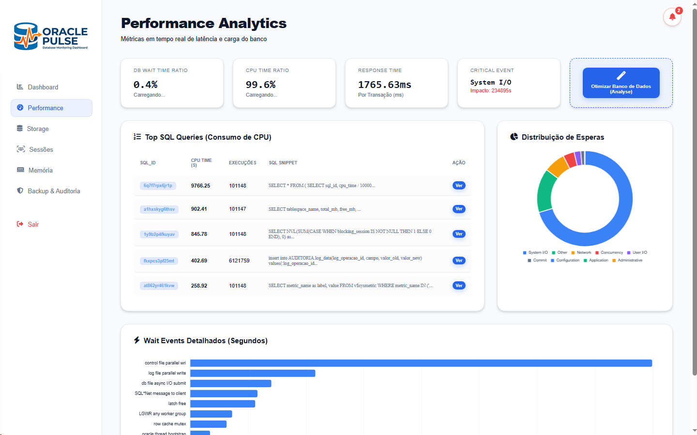
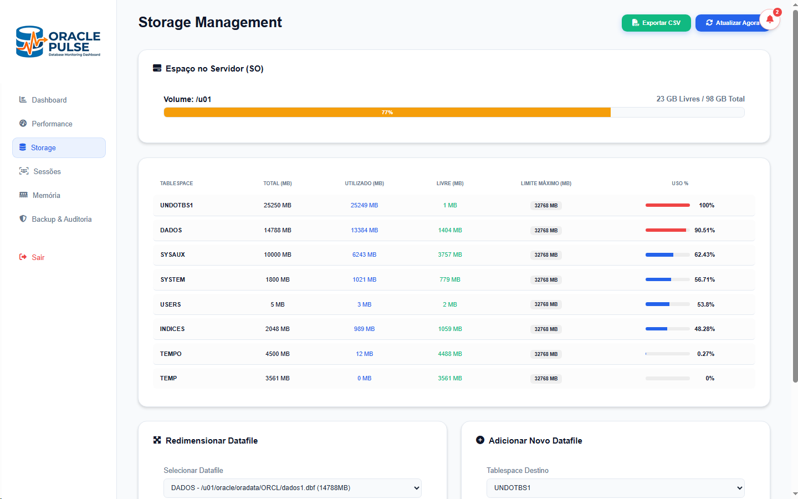
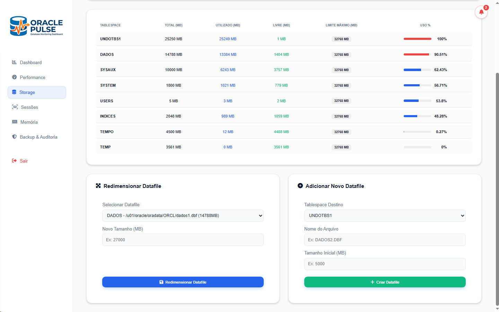
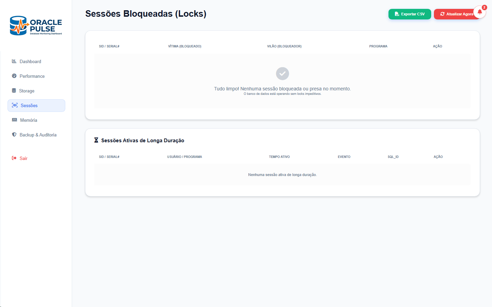
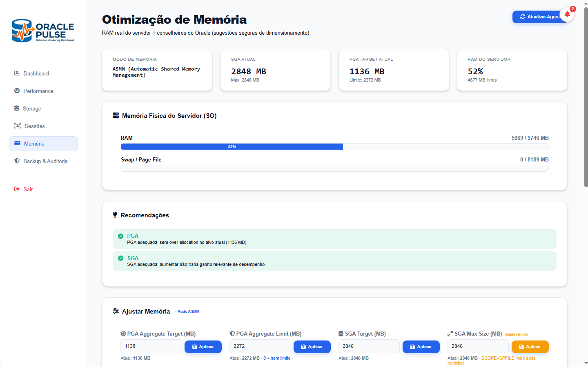
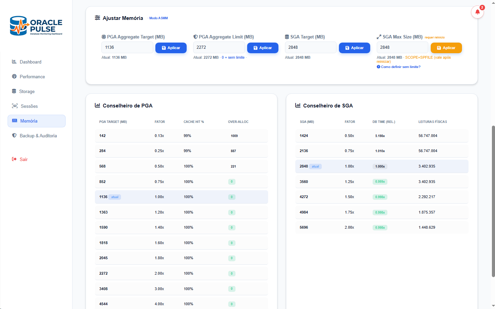
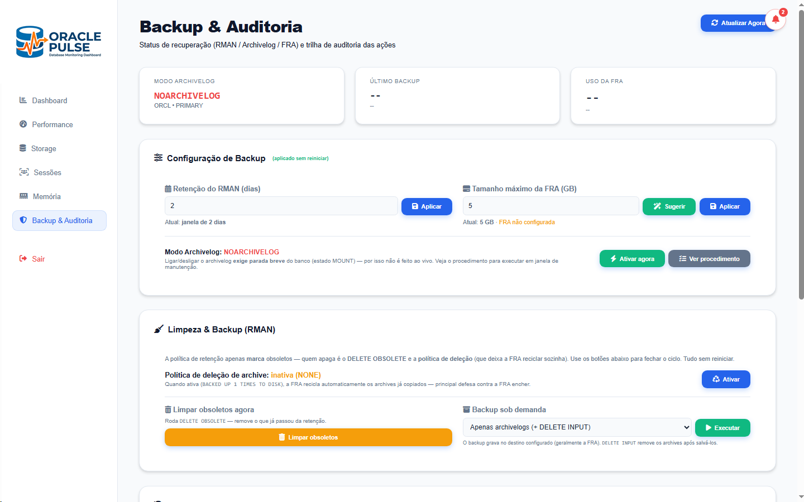
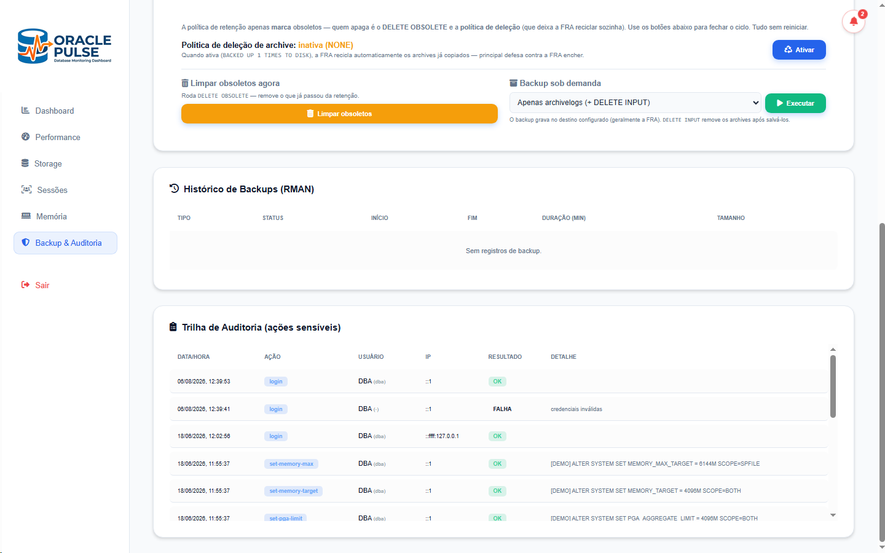

<div align="center">

# ⚡ Oracle Pulse

### Real-time Oracle database monitoring and administration dashboard

[](https://nodejs.org)
[](https://expressjs.com)
[](https://www.oracle.com/database/)
[](https://developer.mozilla.org/en-US/docs/Web/JavaScript)
[](https://www.docker.com)

</div>

---

## 📖 About the project

**Oracle Pulse** is a web-based monitoring and administration dashboard designed for **Oracle Database** environments (performance, active sessions, locks, SGA/PGA memory, tablespace/OS disk storage, backup/recovery, and security auditing). Developed by **Silas Silva** for the client **C&S Sistemas**, it features **real-time metrics**, **interactive execution plans (`DBMS_XPLAN`)**, **remote OS disk inspection via SSH**, **threshold alert notifications**, **role-based access control (DBA & Viewer)**, **dark mode UI**, and a **built-in DEMO mode** for simulation without connecting to a live database.

---

## ✨ Features

- **📊 Real-time Dashboard** — active/blocked sessions, SQL command distribution, memory allocation, top SQL by CPU, wait events, and historical trend chart.
- **⚡ Performance Tuning** — CPU vs Wait ratio analysis, top SQL queries by CPU and elapsed time, `DBMS_XPLAN` execution plans, and table optimization.
- **💾 Storage & Disk Management** — tablespace usage monitoring, OS disk capacity tracking for **every volume that holds datafiles** (e.g. `/u01`, `/u02`, `/u03` or `D:\`, `E:\`, mounted folders and ASM disk groups; local or remote via SSH), data file resizing, and adding new data files to each tablespace's **current directory** (the one holding its most recent datafile) with the next file name suggested and free space checked.
- **🔒 Session & Lock Management** — blocking lock tree analysis (victim vs blocker identification), long-running transaction tracking, and direct session termination (`kill session`).
- **🛡️ Backup, Recovery & Audit** — archivelog status inspection, RMAN backup history, FRA (Fast Recovery Area) utilization, and audit log trail for sensitive DBA actions.
- **🧯 Automatic FRA Protection** — keeps the database from stopping because the Fast Recovery Area filled up, even when the FRA was sized from the suggestion:
  - **Scheduled backups on the server** (cron on Linux, Task Scheduler on Windows), so they run even with the panel off. Strategies:
    - full daily, or weekly level 0 + daily level 1, plus archivelog backups every N hours, each followed by `DELETE OBSOLETE`;
    - **archivelogs only**, for databases whose full backup comes from another tool. Archivelog backups are kept for N days.
  - **Space check before every database backup** (`ORA-19809` prevention). The job estimates the backup size from RMAN history or the database's used space, plus unbacked archivelogs and headroom for redo generated during the backup:
    - if the backup does not fit, it grows the FRA first, within the disk reserve and the optional cap;
    - if it still cannot fit, it backs up only the archivelogs, so the FRA never fills mid-backup, and raises a critical alert (exit code 3).
  - **FRA guard**, checking every minute. It measures real usage minus reclaimable space, growth rate and archivelogs without backup, then acts before the archiver stops:
    - backs up and deletes archivelogs;
    - cleans obsolete files;
    - grows `DB_RECOVERY_FILE_DEST_SIZE`, keeping a disk reserve and an optional cap;
    - dumps archivelogs to an emergency directory on another disk;
    - as an opt-in last resort, deletes archivelogs that have no backup and flags recovery as compromised until the next full backup.
  - **Alerts** in the bell and the webhook for failed, late or stuck backups and for every guard action.
- **🩺 Recovery Assistant** — diagnoses the database in any state (open, mounted, NOMOUNT or down — via `sqlplus` as SYSDBA when the panel cannot connect): instance state, datafiles needing recovery, block corruption (mapped to the affected segment), redo log members/groups, controlfiles, FRA/archiver and the alert log (ORA-00600/07445 by first argument, crash causes, errors inside jobs). Explains each problem, scores recovery readiness, looks up any pasted error (`ORA-`, `RMAN-`, `TNS-`, or phrases like `recover database until cancel`), and runs 22 guided procedures — crash recovery, datafile recover/restore, block media recovery, index rebuild, FRA cleanup, redo member/group repair, incomplete recovery (`UNTIL CANCEL` + `RESETLOGS`), full restore/PITR, controlfile restore, UNDO/TEMP recreation and more — step by step with live output, state-aware commands, a reviewed-plan hash and risk-based confirmations. Readiness warnings come with a one-click fix:
  - **Multiplex redo logs:** adds a 2nd member per group, preferably on another disk, online.
  - **Multiplex the controlfile:** adds a copy via `CONTROL_FILES` in the spfile, a restart to NOMOUNT, then RMAN `RESTORE CONTROLFILE FROM` the current copy.
  - **Enable Flashback Database:** sets the retention target and runs `FLASHBACK ON`, online. Requires EE, ARCHIVELOG and a FRA.
- **🖥️ Server Terminal (DBA)** — runs commands on the database server from the panel, reusing the same channels as the Recovery page and backups: an **OS shell** (local shell, or the SSH session for a remote server), **SQL\*Plus as SYSDBA** (`SET`, `ALTER`, `SELECT`, `STARTUP`/`SHUTDOWN`…), and **RMAN** (`BACKUP`, `RESTORE`, `CROSSCHECK`, `LIST`…). DBA-only, audited, with the SYS password sent over stdin and masked in the output; a `STARTUP`/`SHUTDOWN` reconnects the pool cleanly.
- **🕒 Server Clock vs NTP** — shows the database server's clock drift against an NTP server next to the server time and synchronizes it with one click on **Linux** (chrony, ntpd or systemd-timesyncd over SSH) and **Windows** (w32time; domain members follow the domain controller).
- **🪶 Low Overhead on the Database and Server**
  - **Identifiable queries:** panel queries are tagged `/* OraclePulse */`, and pool sessions use `MODULE = 'Oracle Pulse'`. Top SQL leaves them out and shows their CPU share separately.
  - **Per-query refresh budget:** Top SQL comes from `V$SQLSTATS` once a minute, and tablespace usage is read once a minute. With nobody watching, the background sampler runs only the three queries that history and alerts need.
  - **Browser polling:** only the visible page refreshes, and nothing is requested while the tab is hidden.
  - **SSH reuse:** disk and memory reads go through one persistent SSH connection instead of a new login per command.
- **ℹ️ About & Self-Update** — an "About" page with version/system info and a one-click **update check** against the project's GitHub Releases. On a Windows service install, the DBA can update over the internet: the panel downloads the official installer from the release, verifies its SHA-256, and runs it silently keeping the `.env` (the service stops, updates and restarts).
- **🔔 Threshold Alerts** — automated monitoring and alert triggers for tablespace, disk, memory, and locking thresholds with optional webhook integration.
- **👥 Access Control Profiles** — role-based permissions separating `DBA` (full administrative rights) and `viewer` (read-only monitoring).
- **🧪 DEMO Mode & Customization** — mock data mode for demonstration without live Oracle connection, dark theme UI, and CSV data export.

---

## 🖼️ Screenshots

| System Dashboard | Performance Analytics |
| :---: | :---: |
|  |  |

| Storage Management | Storage Actions & Datafiles |
| :---: | :---: |
|  |  |

| Locks & Session Management | Memory Optimization |
| :---: | :---: |
|  |  |

| Memory Advisors (PGA & SGA) | Backup & RMAN Configuration |
| :---: | :---: |
|  |  |

| Audit Trail & Backup History |
| :---: |
|  |

---

## 🛠️ Technologies

| Layer | Stack |
|---|---|
| **Back-end** | Node.js (v18+), Express 4, CommonJS |
| **Database Integration** | `oracledb` (Oracle Instant Client Thick Mode), Oracle Database 19c+ |
| **Remote Administration** | `node-ssh` (SSH2 OS disk inspection), PowerShell / Bash `df` |
| **Front-end / UI** | HTML5, CSS3, JavaScript (Vanilla ES6+), Chart.js |
| **Security & Auditing** | Custom Token Authentication, Rate Limiting, Action Auditing Log |
| **Containerization** | Docker, Dockerfile |

---

## 🚀 Getting Started

### Prerequisites
- Node.js 18+ and npm
- Oracle Instant Client 64-bit (required for `oracledb` thick mode — on Windows set `ORACLE_CLIENT_PATH`)
- Oracle Database user with read permissions on `V$` and `DBA_` views (and DBA privileges for administrative actions)

### 1. Installation
```bash
npm install
```

### 2. Environment Variables
Create a `.env` file in the root directory (see `.env.example`):
```bash
cp .env.example .env
```
*(On Windows PowerShell, use `copy .env.example .env`)*

Configure your Oracle connection details, server port, and alert settings inside `.env`:
```env
PORT=3000
DEMO_MODE=false
DB_USER=system
DB_PASSWORD=your_password
DB_CONNECT_STRING=localhost:1521/ORCLCDB
ORACLE_CLIENT_PATH=C:\oracle\instantclient_19_19
AUTH_USER=dba_admin
AUTH_PASS_HASH=your_generated_hash
```

### 3. Admin Password Setup
Generate the password hash for your DBA login and paste it into `AUTH_PASS_HASH`:
```bash
npm run hash "YourStrongPassword"
```

### 4. Development & Production Environment
```bash
# Production mode
npm start

# Development mode (auto-reload with node --watch)
npm run dev

# Demo mode (simulated data, no database required)
npm run demo
```
Access `http://localhost:3000` (or the port specified in `PORT`).

---

## 🐳 Docker Deployment

Run Oracle Pulse inside a Docker container:

```bash
# Build the Docker image
docker build -t oracle-pulse .

# Run the container with environment variables file
docker run -p 3000:3000 --env-file .env oracle-pulse
```

---

## 📂 Project Structure

```
├── src/
│   ├── routes/              # Express API route modules (auth, dashboard, storage, memory...)
│   ├── alerts.js            # Threshold alert engine and webhook dispatcher
│   ├── audit.js             # Audit logging for sensitive administrative actions
│   ├── auth.js              # Token authentication, session state, and role access
│   ├── backupAdmin.js       # RMAN backup, archivelog, and FRA management
│   ├── backupPreflight.js   # Space check before each scheduled backup (grows the FRA or skips the DB backup)
│   ├── backupSchedule.js    # Scheduled RMAN backups on the DB server (cron / Task Scheduler)
│   ├── cache.js             # In-memory metrics caching and trend history tracking
│   ├── config.js            # Environment configuration loading & validation
│   ├── dashboardService.js  # Dashboard aggregation, metrics summary & alerts
│   ├── fraGuard.js          # FRA guard: measures the FRA every minute and acts before it fills
│   ├── db.js                # Oracle connection pool, queries execution & SQL sanitization
│   ├── logger.js            # Structured logging service
│   ├── mockData.js          # Mock data generator for DEMO mode
│   ├── osDisk.js            # Local and remote (SSH) OS commands, disk and memory inspection
│   ├── queries.js           # Centralized Oracle SQL query dictionary
│   ├── recovery/            # Recovery Assistant: knowledge base, alert log parser, collector,
│   │                        #   findings engine, playbooks, job executor and DEMO scenarios
│   ├── security.js          # Security headers (Helmet/CSP) and rate limiting
│   ├── storage.js           # Datafile layout and volume usage (multi-volume, ASM)
│   ├── serverTerminal.js    # Server terminal: OS shell / sqlplus (SYSDBA) / RMAN, audited and scrubbed
│   ├── updater.js           # Update check + self-update via GitHub Releases (About page)
│   └── timeSync.js          # Server clock vs NTP (SNTP client + Linux/Windows sync scripts)
├── public/                  # Frontend static files (HTML, CSS, JavaScript, Chart.js)
├── bin/                     # CLI utilities (password hashing, scheduled-job runner for Windows tasks)
├── logs/                    # Audit logs and application logs output
├── server.js                # Application entrypoint (Express initialization & graceful shutdown)
├── Dockerfile               # Container build definition
└── .env.example             # Environment variable template
```

---

## 📜 Available Scripts

| Command | Description |
|---|---|
| `npm start` | Starts the production server |
| `npm run dev` | Runs the server in development mode with auto-reload (`node --watch`) |
| `npm run demo` | Launches the server in DEMO mode using mock data |
| `npm run hash <password>` | Generates a scrypt password hash for authentication |
| `npm test` | Runs the unit tests (`node --test`): storage paths, OS commands, NTP sync and the Recovery Assistant |

---

## 🔒 Security & Access Control

- **Role-Based Access Control (RBAC)**: Destructive actions (kill session, resize tablespace, add datafile, table optimization) are restricted exclusively to **DBA** users.
- **Audit Log Trail**: All administrative operations are logged with timestamp, user identity, IP address, and operation details in `logs/audit.log`.
- **SQL Injection Prevention**: Administrative DDL/DML actions enforce strict whitelist validation (validated SID/serial integers, tablespace names verified against database dictionary).
- **Authentication & Security**: Password hashes generated with constant-time comparison, rate-limited login endpoints, server-side token revocation, and default CSP/security headers.

> ℹ️ It is recommended to deploy Oracle Pulse behind a reverse proxy (e.g., Nginx, Traefik) configured with **HTTPS (TLS/SSL)**.

---

## 👨‍💻 Developer

Developed by **Silas Silva** for **C&S Sistemas**.

---

<div align="center">

⭐ If this project helped you, consider giving it a star.

</div>
